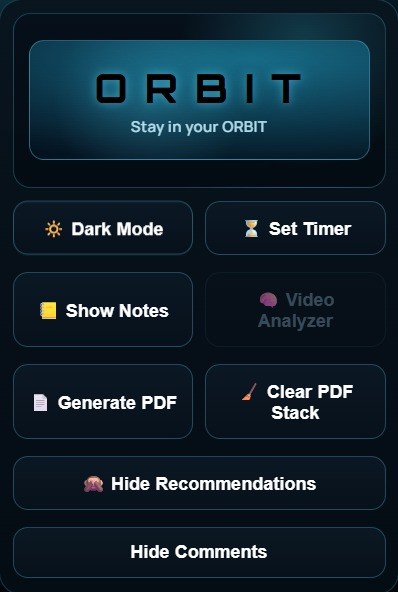
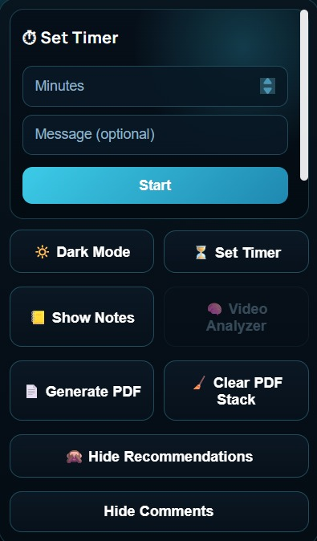
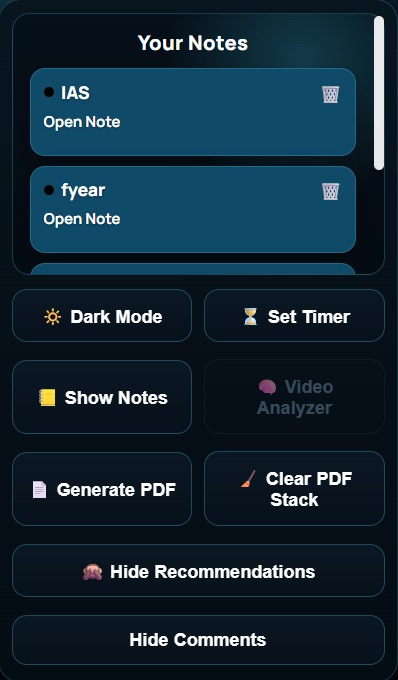
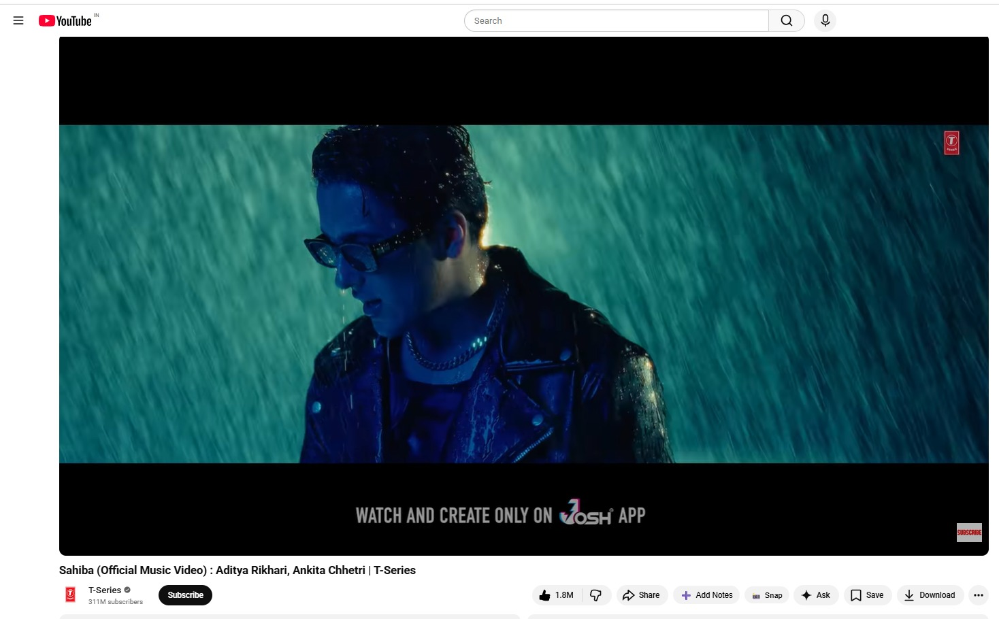
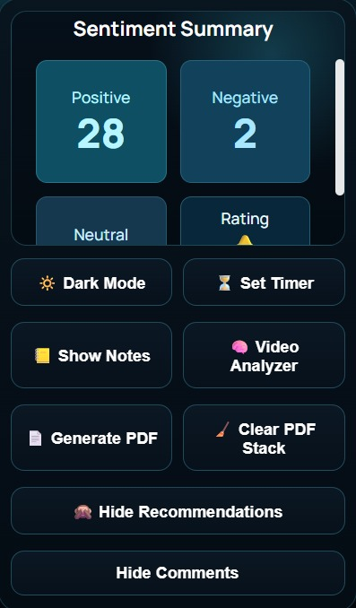

# 🚀 Orbit

<h3 align="center">
  Watch Smarter • Stay Focused • No Distractions
</h3>

<p align="center">
  An open-source Chrome Extension that transforms YouTube into a distraction-free learning environment using Google's Gemma open-weight model.
</p>

<p align="center">
  
  
  
  
  
</p>

---

## 🌍 The Problem

YouTube is an excellent learning platform, but its interface can easily distract users from their learning goals.

- 📺 Recommended videos constantly compete for attention.
- 💬 Comments and discussions can distract learners.
- ⏳ Users often spend more time browsing than learning.
- 🎯 Maintaining focus on a single topic becomes difficult.
- ❓ Learners must manually read numerous comments to understand other viewers' experiences with a video.

The last problem is particularly frustrating. Before investing time in a lengthy tutorial, learners may want to know whether others found it helpful, confusing, or disappointing.

**What if YouTube could help you learn without constantly distracting you?**

---

## 💡 The Solution — Orbit

Orbit transforms YouTube into a focused learning environment by combining distraction control, productivity tools, and locally running AI.

Instead of simply hiding distractions, Orbit helps users make better use of their learning time.

- 🚫 Hide distracting recommendations and comments.
- 📝 Take notes while learning.
- ⏱ Maintain focus with a built-in timer.
- 🌗 Use dark mode for a comfortable viewing experience.
- 📸 Capture useful content and export it as a PDF.
- 🧠 Use Gemma to analyze YouTube comments and understand audience sentiment.
- 🔒 Run AI-powered comment analysis locally using Ollama, without requiring a hosted LLM inference API.

Orbit brings everyday productivity tools and open-weight AI together in a single browser extension.

---

## 🦥 Hacktoberfest 2026 — Week 3: Slow and Steady

Orbit aligns with Hacktoberfest Week 3's **Slow and Steady** theme by using open-weight AI to reduce repetitive manual work.

The idea is simple: learners should spend their time learning, not scrolling through hundreds of comments to determine whether a tutorial is worth watching.

### The Tedious Task

Understanding audience feedback often requires manually reading comments, identifying recurring opinions, and deciding whether a video is useful.

This process takes time and exposes learners to the distractions they are trying to avoid.

### Let Gemma Do the Work

Orbit uses Google's Gemma 3:1B model locally through Ollama to analyze YouTube comments.

1. Extract up to 100 comments from the current YouTube video.
2. Send the comments to the local FastAPI backend.
3. Process the comments using Gemma through Ollama.
4. Classify comments as positive, negative, or neutral.
5. Aggregate the results into an overall sentiment summary.
6. Display the analysis in Orbit so users can assess audience feedback at a glance.

This workflow reduces the need to inspect every comment manually.

### How Orbit Fits the Theme

| Challenge Goal | Orbit's Approach |
|---|---|
| Automate tedious work | Gemma analyzes comments instead of requiring users to read each one individually. |
| Save time and effort | Users can review an aggregated sentiment summary before investing time in a tutorial. |
| Build with open-weight AI | Gemma 3:1B powers the Video Analyzer. |
| Demonstrate practical AI | The model provides a real feature within a working Chrome extension. |
| Explain why open innovation matters | Local inference lets users run the model on their own machines without depending on a hosted LLM inference API. |

Orbit does not claim a specific percentage of time saved. The amount depends on the number of comments, the user's reading speed, and the time needed for local inference.

**The goal: less scrolling, less repetitive work, and more focused learning.**

Challenge details: https://dev.to/challenges/hacktoberfest-week3-2026-10-19

---

## 🧠 Why Gemma?

Orbit uses **Gemma 3:1B, Google's open-weight language model**, through Ollama to power its Video Analyzer.

Gemma is central to the feature: it interprets YouTube comments and classifies their sentiment. The FastAPI backend coordinates the workflow, and Ollama runs the model locally.

### Why Gemma for Orbit?

- **Open-weight AI:** Gemma's openly available model weights allow developers to run the model locally.
- **Local inference:** The model runs on the user's machine through Ollama instead of requiring a hosted LLM inference API.
- **Practical application:** Gemma solves a real user problem rather than appearing only as a technology demonstration.
- **Less manual effort:** Users can review an aggregated analysis instead of manually reading every comment.
- **Flexible experimentation:** Developers can experiment with prompt-driven language-model workflows without training a sentiment classifier from scratch.
- **Greater control:** Users can run inference on their own hardware and inspect or modify the surrounding application code.

### Why Does This Matter?

Open-weight AI makes it possible to build useful AI-powered applications without making every inference request dependent on an external LLM service.

For Orbit, this means the Video Analyzer can process comments locally while the extension continues to provide its focus and productivity features.

The approach also gives developers the freedom to experiment with model prompts, processing logic, and the presentation of results.

**Orbit demonstrates how Gemma can turn a repetitive task into a practical, locally executed AI workflow.**

---

## 🔍 Video Analyzer — Understand a Video Before Investing Your Time

Orbit's Video Analyzer uses Gemma 3:1B to analyze YouTube comments and summarize audience sentiment.

### How It Works

1. **Comment Extraction:** Orbit extracts up to 100 comments from the current YouTube video.
2. **Backend Processing:** The comments are sent to the local FastAPI backend.
3. **Gemma Inference:** The backend batches comments and sends them to Gemma 3:1B through Ollama.
4. **Sentiment Classification:** Gemma classifies comments as positive, negative, or neutral.
5. **Result Aggregation:** The backend processes the results into an overall sentiment summary and a rating based on sentiment and engagement.
6. **Presentation:** Orbit displays the analysis within its interface.

### What Users Get

- 📊 **Sentiment Classification:** Understand the overall tone of the analyzed comments.
- 👍 **Positive Feedback:** Identify favorable audience reactions.
- 👎 **Negative Feedback:** Identify criticism and potential concerns.
- 😐 **Neutral Feedback:** Recognize informational or relatively neutral comments.
- ⭐ **Video Rating:** Get an at-a-glance indication based on sentiment and engagement.

### Why Use Gemma Instead of a Conventional Sentiment Classifier?

Traditional sentiment classifiers generally focus on assigning predefined labels to text.

Gemma provides a flexible, instruction-driven language-model approach that can interpret comments and produce sentiment classifications for the backend to process.

This lets Orbit integrate language-model capabilities without training a separate sentiment model.

**Note:** The output represents estimated audience sentiment from the analyzed comments, not an objective measure of video quality. Sarcasm, spam, ambiguous comments, and model errors can affect the results.

---

## ✨ Features

### 🎯 Focus and Distraction Control

- 🚫 **Hide Recommendations:** Reduce distractions from suggested videos.
- 💬 **Hide Comments:** Keep the viewing experience focused on the video.

### ⚡ Productivity Tools

- 📝 **Notes System:** Save useful notes while learning.
- ⏱ **Focus Timer:** Manage focused learning sessions.
- 🌗 **Dark Mode:** Use a darker interface for a more comfortable viewing experience.
- 📸 **Snapshot to PDF:** Capture useful content and generate a PDF.
- 🧹 **Clear Storage:** Clear locally stored extension data when needed.

### 🧠 Gemma-Powered Smart Analysis

- 🔍 **Video Analyzer:** Analyze comments on the current YouTube video.
- 📊 **Sentiment Classification:** Categorize comments as positive, negative, or neutral.
- ⭐ **Video Rating:** Generate an overall rating based on sentiment and engagement.
- ⚙️ **Local Gemma Inference:** Run Gemma 3:1B through Ollama.
- 📋 **Structured Results:** Process model responses through FastAPI for presentation in the extension.

---

## 🔒 Privacy First — AI That Runs Locally

Orbit is designed to give users greater control over their learning experience and data.

- ✅ **Local AI inference:** Gemma runs locally through Ollama.
- ✅ **No hosted LLM inference API required:** The documented Video Analyzer workflow uses a local model.
- ✅ **Local-first productivity tools:** Extension features use browser-side functionality and local storage where applicable.
- ✅ **User-controlled storage:** Users can clear locally stored extension data.
- ✅ **No cloud-hosted AI backend required:** The documented sentiment-analysis workflow runs on the user's computer.

### What Local Inference Means

When a user analyzes comments, the extension communicates with the local FastAPI backend, which invokes Gemma through Ollama.

The comment-analysis inference does not require sending those comments to a third-party hosted LLM inference service.

However, local inference does not mean the entire application is disconnected from the internet. YouTube content is accessed through YouTube, and the Video Analyzer requires a running local backend and Ollama service.

---

## 🧠 Architecture Overview

Orbit uses three main components to deliver AI-powered comment analysis.

### 🖥 1. Client Layer — Chrome Extension

**Technologies:** HTML, CSS, JavaScript

Responsibilities:

- Interacts with YouTube's page DOM.
- Hides distracting interface elements.
- Provides the notes system and focus timer.
- Adds Orbit controls to the YouTube experience.
- Sends comment-analysis requests to the local backend.
- Displays the sentiment analysis returned by the backend.

### ⚙️ 2. Processing Layer — FastAPI

**Technologies:** Python, FastAPI

Responsibilities:

- Receives comment-analysis requests.
- Processes and batches comments.
- Communicates with the local Ollama service.
- Handles sentiment-analysis responses.
- Aggregates the results.
- Prepares the final response for the extension.

### 🧠 3. AI Layer — Google Gemma

**Model:** Gemma 3:1B  
**Runtime:** Ollama  
**Execution:** Local inference

Responsibilities:

- Interprets YouTube comments.
- Classifies their sentiment.
- Produces responses that the backend can process.

Gemma is the language-model component responsible for AI-powered comment analysis. FastAPI coordinates the processing workflow, while Ollama manages local model inference.

### 💻 Local Execution

The documented Video Analyzer workflow runs on the user's computer:

- Chrome runs the extension.
- FastAPI handles backend requests.
- Ollama runs Gemma 3:1B.
- The extension communicates with FastAPI through the local API.

**No AWS EC2 instance or cloud-hosted backend is required.**

---

## 🔄 Workflow

1. Open a YouTube video in Chrome.
2. Use Orbit to hide distracting recommendations and comments.
3. Take notes and manage focused learning sessions with the built-in timer.
4. Open the Video Analyzer to analyze the video's comments.
5. Orbit extracts up to 100 comments and sends them to the local FastAPI backend.
6. FastAPI processes the comments and invokes Gemma through Ollama.
7. Gemma generates sentiment classifications that the backend processes.
8. Orbit displays the aggregated sentiment analysis to help users assess audience feedback.

---

## 📸 Screenshots

<table align="center">
  <tr>
    <td align="center">
      <b>1. Home Dashboard</b><br/>
      
    </td>
    <td align="center">
      <b>2. Focus Timer</b><br/>
      
    </td>
  </tr>
  <tr>
    <td align="center">
      <b>3. Notes Manager</b><br/>
      
    </td>
    <td align="center">
      <b>4. YouTube Integration</b><br/>
      
    </td>
  </tr>
  <tr>
    <td colspan="2" align="center">
      <b>5. Gemma-Powered Sentiment Summary</b><br/>
      
    </td>
  </tr>
</table>

---

## ⚙️ Installation

### Prerequisites

Before starting, make sure you have:

- Google Chrome
- Python 3.12
- Ollama installed
- Sufficient local resources to run Gemma 3:1B
- Git

### 1. Clone the Repository

```bash
git clone https://github.com/Rajat-Soni1058/ORBIT.git
cd ORBIT